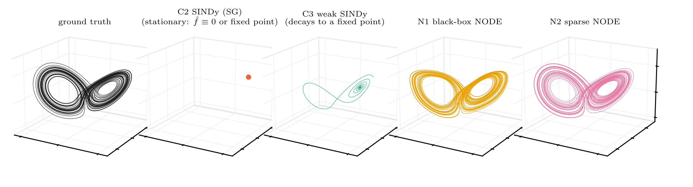
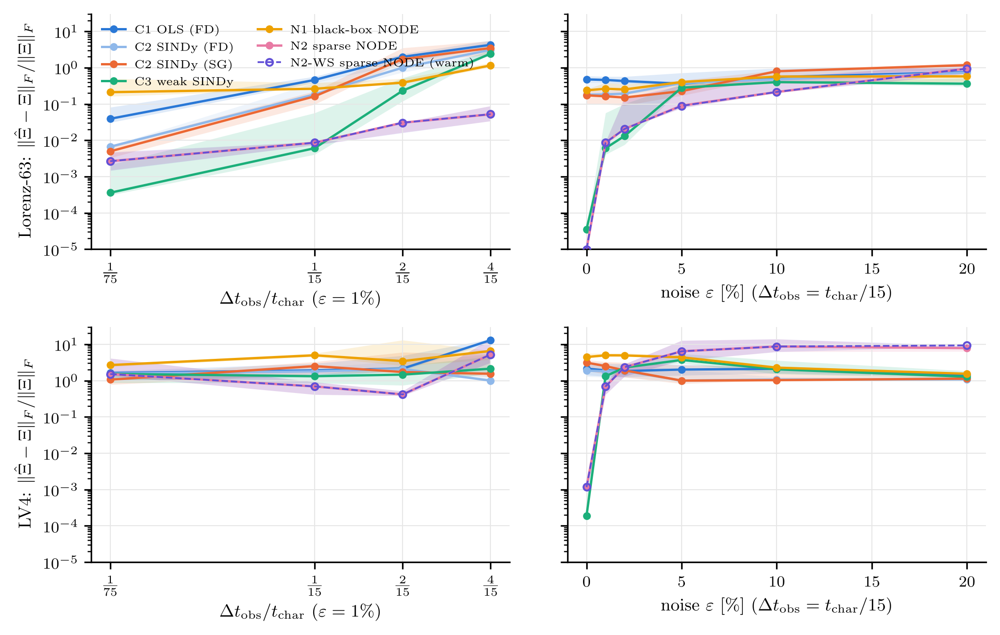
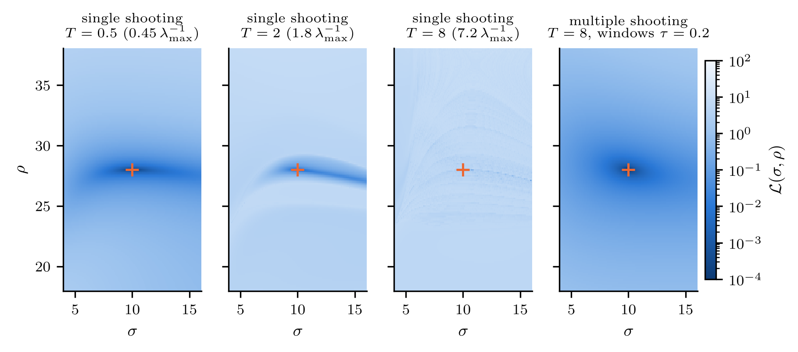
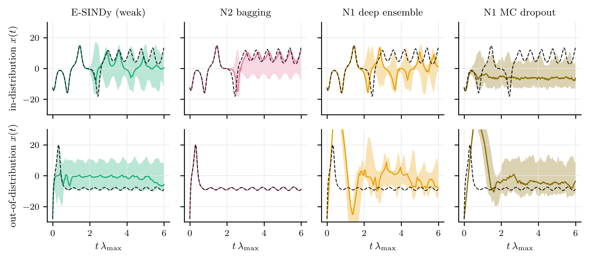
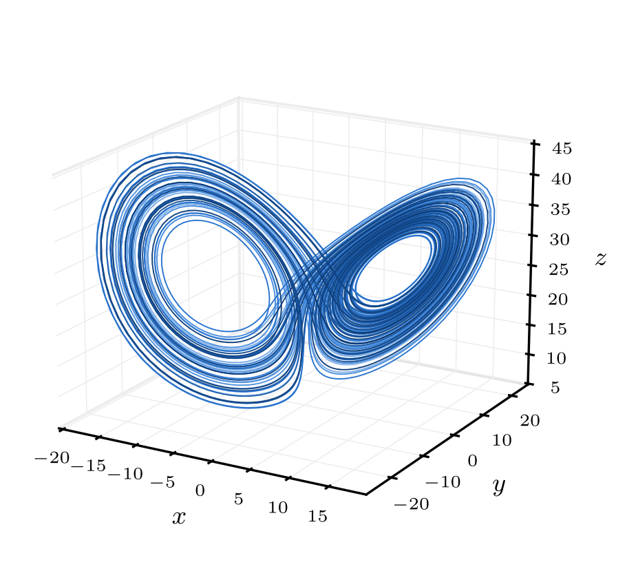
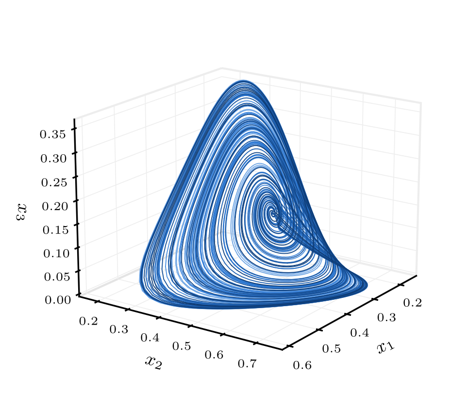

# Learning and Discovering Chaotic Dynamics from Sparse, Noisy Observations
[](https://doi.org/10.5281/zenodo.23464920)
<p align="center">
  
</p>
<p align="center"><em>Free runs of the models identified from Lorenz-63 data sampled every 0.2 time units (≈ 4 samples per oscillation) with 1% noise. From left to right: ground truth, SINDy (Savitzky–Golay derivatives), weak SINDy, black-box neural ODE, sparse-library neural ODE.</em></p>

> **Preprint v1:** neural models are evaluated on a sub-grid; the full GPU grid is planned for v2.

## Abstract

This project measures how well data-driven methods recover the governing equations of chaotic systems, and forecast their trajectories, from short records that are sparsely sampled and noisy. We compare dense least squares, SINDy, weak SINDy, a black-box neural ODE and a sparse-library neural ODE on Lorenz-63 and on a chaotic four-species Lotka–Volterra model. All methods get identical data and the same held-out model selection, over a grid of sampling intervals and noise levels.

The sparse neural ODE is trained by differentiating through a Runge–Kutta integrator. Its training combines a Levenberg–Marquardt flow-map stage, quasi-Newton multiple shooting with joint state estimation and continuation in the window length, multistart, and thresholding along a regularisation path.

Exact loss slices and random-restart experiments show why these devices are needed. Single-shooting trajectory matching turns into a flat surface with a needle-like minimum after about one Lyapunov time, and its gradients grow exponentially with the horizon.

With about four samples per oscillation and 1% noise, the sparse neural ODE recovers the Lorenz equations (median coefficient error 0.05), where every derivative-based and weak-form estimator fails. Black-box neural ODEs give no usable equations and fail immediately off the attractor. For the Lotka–Volterra model, the library is so badly conditioned on the data that no estimator recovers the coefficients from noisy records.

Uncertainty is quantified with bootstrap ensembles, deep ensembles and Monte Carlo dropout, and scored by coverage and CRPS on in-distribution and out-of-distribution initial conditions.

## Problem

We observe $E$ short experiments of an unknown autonomous system $\dot x = f(x)$, $x\in\mathbb R^d$, on a grid of step $\Delta t_{\rm obs}$ with additive Gaussian noise:

$$y^{(e)}_k = x^{(e)}(t_k) + \eta^{(e)}_k,\qquad \eta^{(e)}_k\sim\mathcal N\big(0,\ \varepsilon^2\,\mathrm{diag}(\sigma_1^2,\dots,\sigma_d^2)\big).$$

The vector field is assumed to lie in the span of a degree-2 monomial library $\theta(x)\in\mathbb R^p$, so that $f(x)=\Xi^\top\theta(x)$ with a sparse $\Xi\in\mathbb R^{p\times d}$. The goals are:

- **equation recovery**: estimate $\Xi$, measured by $\lVert\hat\Xi-\Xi\rVert_F/\lVert\Xi\rVert_F$ and support $F_1$;
- **forecasting**: valid prediction time in Lyapunov times, both in-distribution and from out-of-distribution initial conditions, plus long-run invariant statistics ($W_1$ distance, $\lambda_{\max}$);
- **calibrated uncertainty**: interval coverage and CRPS of ensemble forecasts.

Integration-based estimators minimise a trajectory-matching objective. On a chaotic flow the parameter sensitivities $\partial x(t)/\partial\vartheta$ grow like $e^{\lambda_{\max}t}$, so the single-shooting loss

$$\mathcal L_T(\vartheta)=\frac1n\sum_{k=1}^n\big\lVert \Phi^{t_k}_\vartheta(x_0)-y_k\big\rVert^2_{\Sigma^{-1}}$$

becomes rough as the horizon $T$ grows. We use multiple shooting with latent states $S_i$ and windows of $K$ observation intervals,

$$\mathcal J_K(\vartheta,S)=\frac{1}{|\mathcal W|K}\sum_{i\in\mathcal W}\sum_{k=1}^{K}\big\lVert\Phi^{t_{i+k}-t_i}_\vartheta(S_i)-y_{i+k}\big\rVert^2_{\Sigma^{-1}}+\frac{w}{N}\sum_i\lVert S_i-y_i\rVert^2_{\Sigma^{-1}},$$

together with continuation in $K$ starting from a one-step flow-map regression, and multistart.

## Systems and estimators

| system | $d$ | active terms | $t_{\rm char}$ | $\lambda_{\max}$ |
|---|---|---|---|---|
| Lorenz-63 $(10, 28, 8/3)$ | 3 | 7 / 30 | 0.75 | 0.906 |
| 4-species competitive Lotka–Volterra (Vano et al., 2006) | 4 | 17 / 60 | 35 | 0.020 |
| predator–prey (non-chaotic control) | 2 | 4 / 12 | 8 | 0 |

| | estimator | derivative information |
|---|---|---|
| C1 | dense least squares | central differences |
| C2 | SINDy / STLSQ | central differences or Savitzky–Golay |
| C3 | weak SINDy | none (integration by parts) |
| N1 | black-box neural ODE + symbolic distillation | none (multiple shooting, Adam) |
| N2 | sparse-library neural ODE | none (Levenberg–Marquardt flow map → L-BFGS multiple shooting with continuation → thresholding path) |

## Main results

**Equation recovery** (median relative coefficient error over 3 seeds, $\varepsilon=1\%$ noise):

| Lorenz-63, $\Delta t_{\rm obs}$ | 0.01 | 0.05 | 0.10 | 0.20 |
|---|---|---|---|---|
| C2 SINDy (Savitzky–Golay) | 0.005 | 0.16 | 1.7 | 3.5 |
| C3 weak SINDy | **0.0004** | **0.006** | 0.23 | 2.4 |
| N1 black-box NODE (distilled) | 0.21 | 0.26 | 0.39 | 1.15 |
| N2 sparse NODE | 0.003 | 0.009 | **0.031** | **0.052** |

**Forecasting.** At 1% noise, N2 has the longest in-distribution valid prediction time at every sampling interval on both systems: 3.5 Lyapunov times at $\Delta t=0.2$ on Lorenz, against at most 0.17 for the classical methods. From initial conditions at least 2σ off the attractor, the black-box NODE fails at once (VPT 0.015), while sparse models with the right support keep 3.3–7.1 Lyapunov times.

<p align="center">
  
</p>

**Loss landscapes.** Single shooting turns into a flat surface with a needle-like minimum as the horizon grows, and the median gradient norm grows like $e^{0.68T}$ ($\lambda_{\max}=0.91$). Of 96 random restarts for $(\sigma,\rho,\beta)$, 0% succeed with single shooting over $T=4$ and 100% with multiple shooting on windows of 0.2.

<p align="center">
  
</p>

**Uncertainty** (Lorenz, $\Delta t=0.05$, 1% noise):

| | 90% coverage ID / OOD | CRPS ID / OOD | OOD/ID spread |
|---|---|---|---|
| E-SINDy (weak) | **0.87 / 0.93** | 0.16 / 0.22 | 15.4 |
| N2 window bagging | 0.18 / 0.11 | **0.10 / 0.07** | 3.9 |
| N1 deep ensemble | 0.41 / 0.47 | 0.51 / 1.35 | 11.9 |
| N1 MC dropout | 0.67 / 0.64 | 0.64 / 0.96 | 1.1 |

<p align="center">
  
</p>

**Identifiability.** On noise-free data the library matrix has condition number ≈ 120 for Lorenz and ≈ 3·10⁴ for the four-species LV model, even with four perturbed experiments. LV4 coefficients are recovered only from noise-free records, by every method. Trajectory matching still gives the best LV4 forecasts.

<p align="center">
  
  
</p>

## Repository layout

```
├── notebooks/
│   ├── 01_data_generation_eda.ipynb   SciPy simulation, corruption grid, 3-D attractors, library conditioning
│   ├── 02_classical_baselines.ipynb   C1–C3 on the full grid (2 systems × 4 Δt × 6 noise levels × 3 seeds)
│   ├── 03_neural_ode.ipynb            N1, N2, N2-WS on the cross-shaped sub-grid
│   ├── 04_loss_landscapes.ipynb       exact loss slices, gradient growth, basins of attraction, NN landscape
│   ├── 05_uncertainty_ood.ipynb       E-SINDy, window bagging, deep ensembles, MC dropout; ID vs OOD
│   └── 06_benchmark_summary.ipynb     merged benchmark, LaTeX tables, attractor galleries
├── src/                               systems, library, integrators, SINDy family, neural ODEs, metrics
├── results/figures/                   every figure (PDF + PNG)
├── results/metrics/                   CSV / JSON exports of every number in the paper
├── paper/                             paper.tex / paper.pdf, poster.tex / poster.pdf
├── RUN_ON_COLAB.ipynb                 full neural grid (720 trainings) on a GPU runtime
└── requirements.txt
```

## Setup

```bash
python -m venv .venv && source .venv/bin/activate
pip install -r requirements.txt
cd notebooks
jupyter nbconvert --to notebook --execute --inplace 01_data_generation_eda.ipynb   # ~1 min
jupyter nbconvert --to notebook --execute --inplace 02_classical_baselines.ipynb   # ~20 min on 2 cores
jupyter nbconvert --to notebook --execute --inplace 03_neural_ode.ipynb            # ~4 h on 2 cores (cached afterwards)
jupyter nbconvert --to notebook --execute --inplace 05_uncertainty_ood.ipynb       # ~1 h
jupyter nbconvert --to notebook --execute --inplace 04_loss_landscapes.ipynb       # ~30 min
jupyter nbconvert --to notebook --execute --inplace 06_benchmark_summary.ipynb     # ~5 min
```

Trained models are cached in `results/models/`, so re-running a notebook only retrains what is missing. Set `SCD_DEVICE=cuda` to train on a GPU.

The paper compiles with `latexmk -pdf paper.tex` and the poster with `xelatex poster.tex`, both from `paper/` (TeX Live 2023 or later). The Lato and Raleway font files used by the poster are included in `paper/fonts/`.

## Tech stack

- **NumPy**: monomial libraries, STLSQ, weak-form assembly, vectorised RK4 rollouts, Benettin exponents.
- **SciPy**: `solve_ivp` (DOP853) ground truth, Savitzky–Golay filters, KD-trees, Wasserstein distances.
- **PyTorch** (float64): neural and library vector fields, differentiable RK4, Adam / L-BFGS, forward-mode Jacobians for Levenberg–Marquardt.
- **Matplotlib** with LaTeX text rendering for all figures.

## Reproducibility notes

- Ground truth uses DOP853 at `rtol=1e-10`, `atol=1e-12`. Every learned model is rolled out with the same RK4 step $h=t_{\rm char}/75$.
- Every hyper-parameter (threshold, Savitzky–Golay window, test-function width, sparsity path) is selected on held-out blocks. No estimator sees the true coefficients.
- Seeds fix the experiments' initial states and the noise. The neural models are trained in double precision.

## Citation

```bibtex
@techreport{aime2026sparsechaos,
  author      = {Aim{\'e}, Paul Christopher},
  title       = {Learning and Discovering Chaotic Dynamics from Sparse, Noisy Observations},
  institution = {{\'E}cole Nationale des Sciences Appliqu{\'e}es de Marrakech, Universit{\'e} Cadi Ayyad},
  year        = {2026}
}
```
